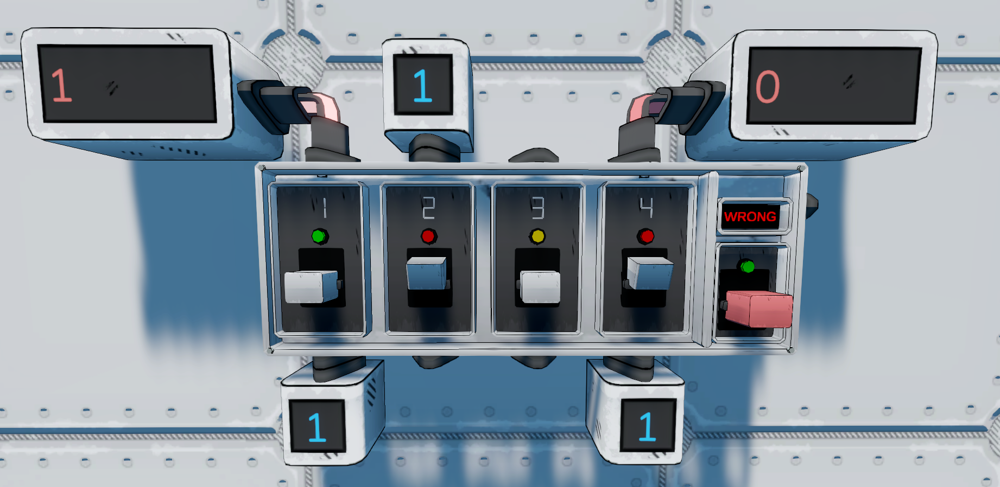

If you find any bug tell me on discord: benmal0_0
# Breaker Box — StellarDrive Demo

[English below](#english)

**Versão 1.3.0 · Criado por Ghost**

Uma caixa de disjuntores para organizar e interromper os cabos da sua nave. Monte-a na parede, conecte os cabos e controle quatro canais independentes, com chave geral e desarme automático por limite de sinal.

## Recursos

- Quatro canais independentes, cada um com entrada, saída e alavanca.
- Chave geral para desligar e desarmar todos os disjuntores.
- Entrada `TRIP` para desarme remoto automático.
- Limites selecionáveis: `NO LIMIT`, `>1`, `>5`, `>10`, `>50` e `>100`.
- LEDs de estado, alavancas animadas e visor com limite ou maior sinal de entrada.

## Instalação

### Requisitos

- **MelonLoader**.
- **SDModKit** feito por Krunk.

### Passo a passo

1. Feche o jogo.
2. Instale o MelonLoader e o SDModKit, caso ainda não estejam instalados.
3. Baixe o [ZIP da versão 1.3.0](https://github.com/snowzy-byte/StellarDrive-BreakerBox/releases/download/v1.3.0/StellarDrive-BreakerBox.zip?download=1) e extraia seu conteúdo na pasta de instalação do jogo, mesclando a pasta `Mods`.
4. Inicie o jogo e procure **Breaker Box** no menu de construção.
5. Monte a caixa em uma parede e conecte os cabos de sinal.

## Como usar

| Controle | Função |
| --- | --- |
| Alavancas dos canais | Alternam o canal entre ON e OFF. |
| Alavanca vermelha | Chave geral: ao desligar, desarma os quatro canais. |
| Visor | Avança para o próximo limite e mostra a seleção. |
| LED da chave geral | Alterna entre o limite selecionado e o maior sinal de entrada. |
| Socket `TRIP` | desarma os quatro canais. |

Cada canal liga seu socket de entrada ao de saída quando armado. Ao exceder o limite, somente o canal afetado desarma. Os demais continuam no estado em que estavam.

O desarme permanece até o rearme manual. Ligar a chave geral novamente **não rearma automaticamente** os canais.

### LEDs

| Cor | Estado |
| --- | --- |
| Vermelho | Canal desligado ou desarmado. |
| Amarelo | Canal armado, sem sinal na entrada. |
| Verde | Canal armado com sinal positivo na entrada. |

O LED da chave geral fica verde quando ligada e apagado quando desligada.

---

## English

**Version 1.3.0 · Created by Ghost**

A breaker box for organizing and interrupting your ship's signal wiring. Mount it on a wall, connect the cables and control four independent channels, with a master switch, remote trip and signal limit protection.

### Features

- Four independent channels, each with its own input, output and handle.
- A master switch to turn off and disarm all breakers.
- A `TRIP` input for automatic remote tripping.
- Selectable limits: `NO LIMIT`, `>1`, `>5`, `>10`, `>50` and `>100`.
- Status LEDs, animated handles and a display showing the limit or highest input signal.

### Installation

#### Requirements

- **MelonLoader**.
- **SDModKit** by Krunk.

#### Step by step

1. Close the game.
2. Install MelonLoader and SDModKit if they are not already installed.
3. Download the [version 1.3.0 ZIP](https://github.com/snowzy-byte/StellarDrive-BreakerBox/releases/download/v1.3.0/StellarDrive-BreakerBox.zip?download=1) and extract its contents into the game installation directory, merging the `Mods` folder.
4. Start the game and look for **Breaker Box** in the build menu.
5. Mount the box on a wall and connect the signal cables.

### How to use

| Control | Function |
| --- | --- |
| Channel handles | Switch the channel between ON and OFF. |
| Red handle | Master switch: switching it off disarms all four channels. |
| Display | Advances to the next limit and shows the selection. |
| Master switch LED | Switches between the selected limit and highest input signal. |
| `TRIP` socket | Disarms all four channels. |

Each channel connects its input socket to its output socket when armed. When the limit is exceeded, only the affected channel trips. The other channels remain in their current state.

A tripped channel remains disarmed until it is manually reset. Turning the master switch back on **does not automatically rearm** the channels.

#### LEDs

| Color | State |
| --- | --- |
| Red | Channel switched off or tripped. |
| Yellow | Channel armed, with no input signal. |
| Green | Channel armed with a positive input signal. |

The master switch LED is green when on and dark when off.
